# Factory

<p align="center"></p>

**A software factory for a solo founder, as a [bb](https://getbb.app) plugin.**
Tickets move through plan, plan review, build, code review and ship without
you carrying them from agent to agent. Every stage is a fresh agent on the
model you chose for that role. You are asked only for product decisions, in
one inbox, and you try anything your users will see before it ships.

It was built while shipping a real mobile app to real testers, with agents
doing nearly all of the engineering and one person deciding what to build.
Everything here exists because something went wrong without it.

> **Status: first public draft.** The engine runs a real project daily. The
> bundled skills, the scripts, the onboarding and the mobile pack were
> generalized from that project and have not yet been run on a second one.
> Expect to adjust them; that is what the Mechanic is for.

## What you get

- **Swimlanes.** Tickets that would collide (same files, same deploy slot,
  one depending on another) share a lane and run one at a time. Lanes run
  side by side, up to a limit you set. Every plan declares the files it
  will touch; a script finds the overlaps and the tracker's blockers, the
  Architect judges which are real collisions, and the script refuses a
  schedule that contradicts the evidence.
- **Rules that are scripts, not reminders.** An agent told to "make sure
  the review covers this commit" will sometimes not. So the rules that
  matter are scripts that refuse: which plan belongs to a branch, whether a
  review is recorded for the exact commit being shipped, whose turn it is to
  merge, whose turn it is on a shared dev resource. See [`kit/`](kit/).
- **Linear, built in.** Agents read, file, label and close tickets through
  one script; the scheduler reads Linear's blockers and labels. Or run with
  no tracker at all.
- **A pipeline of independent agents.** Each stage runs in its own thread,
  in the ticket's own git worktree. A reviewer never shares context with the
  author it reviews, and reviewers fix what they find instead of handing it
  back.
- **A model per role.** Strong models plan and review; cheaper ones build
  from a contract. Plans declare an implementer tier, and the tier picks the
  builder. Each role can name a fallback for when a usage limit runs out.
- **One inbox.** Decisions arrive with the situation, the options as your
  users would experience them, and a recommendation. Your answer goes back
  to the thread that asked. Stalls and failures land there too.
- **An owner per ticket.** The agent that reviewed a ticket's plan fields
  its builder's questions and your feedback until it ships, so technical
  questions stop reaching you.
- **You try it before it ships.** A ticket that changes a screen waits at a
  gate with a before/after image, a test account and numbered steps.
- **Standing agents** that run for weeks, each with a memory file in your
  repository:

  | Agent | Job |
  |---|---|
  | **Architect** | Holds the picture. Decides what becomes work, files and plans every ticket, sets the lanes. |
  | **Mechanic** | Improves the factory itself: the plugin, the skills, the checks. Onboards your project and runs a weekly retro. |
  | **Observer** | Reads what real users did each day, plus errors and feedback, and hands findings to the Architect. |
  | **Deployer** | Releases when you ask, by your runbook. Never on its own. |
  | **Integrator** | Keeps dependencies and tooling current. |
  | **Cleaner** | Keeps the machine the factory runs on healthy. |

- **Process skills you can read and change.** How to plan, review a plan,
  build, review code, ship, schedule and diagnose a bug are plain markdown
  in [`skills/`](skills/). Your project's own skills replace any of them.
- **A mobile pack.** Release routing (over-the-air or store build), UI
  previews without a device, performance and gesture guidance for React
  Native / Expo apps, in [`packs/mobile`](packs/mobile/).

## Quick start

Needs bb 0.49 or later, a git project, and at least one agent provider
(Claude Code, Codex, or anything bb runs).

**1. Fork, clone, install.** Fork
[gmemmanuel/solo-factor](https://github.com/gmemmanuel/solo-factor) first:
you are meant to change this.

```sh
git clone https://github.com/<you>/solo-factor.git factory
cd factory
npm install
bb plugin install .
```

Open **Factory** in bb's navigation rail and pick your project.

**2. Start the Mechanic.** Factory → Agents → Mechanic → Start (or
`bb factory agent start harness-improver`). Tell it:

> I'm new to the factory. Set it up for this project.

It explains how the factory works, reads your codebase and how you already
work with agents (your `AGENTS.md`, skills, CI, commit history), installs
the scripts into `scripts/factory/`, and writes a
[`FACTORY.md`](templates/FACTORY.md) profile in your repository: the
commands that verify work, where plans and tickets live, what agents may do
unasked. It tells you where your existing instructions conflict with a
pipeline nobody is watching, and what it would change. Then it works down a
setup list of what your project lacks: turn-taking for shared dev
resources, a way to render screens without a device, a deploy runbook, the
Observer's checks.

**3. Answer its questions in the inbox.** These are the choices only you can
make:

| Choice | Its recommendation, usually |
|---|---|
| Which model plays each role, and its fallback | Strongest on Architect, plan review and code review; cheaper on tier 1 builds and ship |
| What you must try before it ships | Anything that changes a screen or its words |
| Who merges | The ship stage on green CI, once you have watched a few tickets |
| What agents may do unasked in dev | Deploy to dev, seed test accounts; never touch production |
| Which standing agents to start | Architect and Mechanic now; Observer when there are real users |
| How many tickets at once | 2 or 3 to start |
| Linear, or no tracker | Linear if you already use it |
| Keep your own skills or use the bundled ones, per stage | Yours where they exist and are good |

**4. Start the Architect** and bring it one small, real change. It files,
plans and queues the ticket; the pipeline does the rest. That first ticket
is the test of your profile: every question a stage asks that the profile
should have answered becomes a line in `FACTORY.md`.

**5. Make it yours.** When something about the factory annoys you, tell the
Mechanic. It changes the profile, the configuration, a skill or the engine,
whichever is smallest, in your clone, and proves the change. It also runs a
weekly retro on what cost you attention.

More: [docs/CUSTOMIZING.md](docs/CUSTOMIZING.md).

## How it fits together

```text
You ──► Architect ── files, plans, queues ──► swimlanes
                                                 │  each ticket: its own worktree
                                                 ▼
        plan review ─► build ─► code review ─► (you try it) ─► ship
        (issue owner)     │          │
                          └── questions go to the issue owner, not to you

Observer ── what users did, errors, feedback ──► Architect
Mechanic ── retro: what cost attention ──► changes to skills, profile, engine
```

Four layers, four owners:

| Layer | Lives in | Holds |
|---|---|---|
| **Flow** | the plugin's engine | lanes, stages, handoffs, the inbox, gates. No opinion on how work is done |
| **Process** | `skills/` in your clone | how to plan, review, build, ship; the standing agents' charters |
| **Enforcement** | `kit/`, installed into your repository as `scripts/factory/` | the rules that must not depend on an agent remembering them |
| **Project** | `FACTORY.md`, `factory.config.json` and your own skills, in your repository | commands, paths, rules, your stack |

## The scripts

Plain Node, no dependencies, tested (`npm run test:kit`). Onboarding copies
them into your project; they are yours to change.

| Script | What it refuses |
|---|---|
| `plan-doc.mjs` | Guessing which plan a branch belongs to. Exit 0 is the plan, exit 3 a verified small bug, exit 1 anything else: a missing plan is never small-bug evidence |
| `plan-surfaces.mjs` | A plan that does not declare the files it will touch, or declares a path that cannot exist |
| `review-receipt.mjs` | Shipping a commit no review covers. A review ends with a receipt bound to the exact commit; later changes need a recorded closeout; a blocked review never ships |
| `ship-turn.mjs` | Two branches landing at once. One turn from "merge base" to "merged", so CI tests the tree that lands; merges itself on green |
| `turn.mjs` | Two branches using one dev deploy slot, staging database or device at the same moment. Turns expire, so a dead session cannot block the rest |
| `sequence.mjs` | A swimlane schedule that is stale, leaves a ticket out, reshuffles running work, or ignores a blocker or an unjudged file overlap |
| `linear.mjs` | (helper) Tickets from an unattended thread: read, file, label, comment, close |

## For agents and scripts

Factory threads get native tools (`factory_stage_done`, `factory_ask_founder`,
`factory_ask_planner`, `factory_message`, and for standing agents
`factory_enqueue` and `factory_status`). Everything is also on the command
line:

```sh
bb factory status
bb factory enqueue APP-12 "Coupon applies twice" --lane Checkout --pipeline planned --tier 1
bb factory role ship --provider codex --model <model-id> --reasoning low
bb factory stage plan --prompt 'Use the `my-plan` skill to plan {key}: {title}.\n\n{brief}'
bb factory prompt watch "Run the daily review."     # for scheduled automations
bb factory inbox
bb factory help
```

| Pipeline | Stages | Use for |
|---|---|---|
| `planned` (default) | Plan review → Build → Code review → Ship | A ticket the Architect planned |
| `full` | Plan → Plan review → Build → Code review → Ship | A ticket with no plan yet |
| `reviewed` | Build → Code review → Ship | A plan already reviewed elsewhere |
| `small-bug` | Fix | A fix too small to plan; rides with the next planned ticket |

Roles, stages, pipelines and standing agents are configuration, stored per
bb project.

## Coming soon

- **Tickets inside the factory.** A ticket system on the Factory page, so a
  project needs no tracker: tickets, their plans and their history in one
  place, filed and moved by the same agents. It replaces Linear for anyone
  who wants it to.
- **A reference UI preview harness** for the mobile pack, so the founder's
  before/after image works on day one.
- **`bb factory init`**: the mechanical half of onboarding in one command.
- **More than one decision-maker.**

## Works well with

All built into bb: **Concurrency limit** (cap running threads),
**Automations** (schedule the Observer's checks and the weekly retros),
**Push notifications** (the inbox on your phone), **GitHub PR status**.

## Development

```sh
npm run verify                  # typecheck, engine tests, script tests, build
node scripts/live-check.mjs     # end to end on a throwaway bb server, with a fake model
```

Read [AGENTS.md](AGENTS.md) before changing anything, then
[docs/ARCHITECTURE.md](docs/ARCHITECTURE.md) and [LEARNINGS.md](LEARNINGS.md),
which records what bb's plugin SDK does that its documentation does not
make obvious.

## License

MIT.
